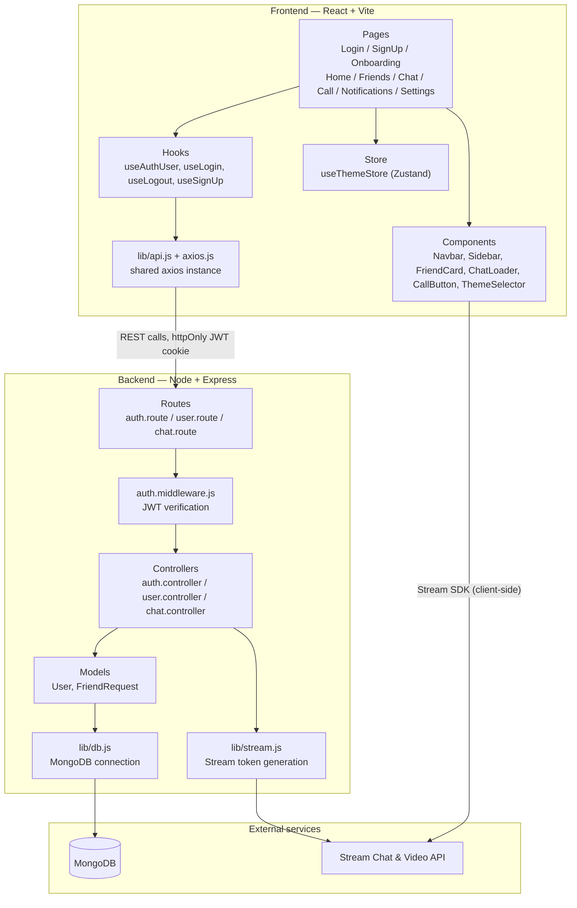

# Architecture

## High-level architecture



The frontend never talks to Stream's API directly for auth — it calls the backend for a Stream token (`lib/stream.js`), then uses that token to connect the Stream Chat/Video client in the browser.

## Technology stack

**Frontend**: React, Vite, React Router, TanStack Query, Zustand (`useThemeStore`), Axios, Tailwind CSS, DaisyUI, Stream Chat & Stream Video SDKs.

**Backend**: Node.js, Express, MongoDB with Mongoose, JWT (httpOnly cookies) for auth, Stream Chat & Stream Video server SDK for token generation.

**Hosting**: Render (free tier), with a keep-alive cron job to avoid cold starts.

## Folder structure

```
Streamify/
├── Backend/
│   └── src/
│       ├── controllers/
│       │   ├── auth.controller.js
│       │   ├── chat.controller.js
│       │   └── user.controller.js
│       ├── lib/
│       │   ├── db.js              # MongoDB connection
│       │   └── stream.js          # Stream token generation
│       ├── middleware/
│       │   └── auth.middleware.js # JWT verification, protects routes
│       ├── models/
│       │   ├── FriendRequest.js
│       │   └── User.js
│       ├── routes/
│       │   ├── auth.route.js
│       │   ├── chat.route.js
│       │   └── user.route.js
│       └── server.js              # entry point
│
├── Frontend/
│   └── src/
│       ├── components/
│       │   ├── CallButton.jsx
│       │   ├── ChatLoader.jsx
│       │   ├── FriendCard.jsx
│       │   ├── Layout.jsx
│       │   ├── Navbar.jsx
│       │   ├── NoFriendsFound.jsx
│       │   ├── NoNotificationsFound.jsx
│       │   ├── PageLoader.jsx
│       │   ├── Sidebar.jsx
│       │   └── ThemeSelector.jsx
│       ├── constants/
│       ├── hooks/
│       │   ├── useAuthUser.js
│       │   ├── useLogin.js
│       │   ├── useLogout.js
│       │   └── useSignUp.js
│       ├── lib/
│       │   ├── api.js             # API call wrappers
│       │   ├── axios.js           # shared axios instance
│       │   └── utils.js
│       ├── pages/
│       │   ├── CallPage.jsx
│       │   ├── ChatPage.jsx
│       │   ├── FriendsPage.jsx
│       │   ├── HomePage.jsx
│       │   ├── LoginPage.jsx
│       │   ├── NotificationsPage.jsx
│       │   ├── OnboardingPage.jsx
│       │   ├── SettingsPage.jsx
│       │   └── SignUpPage.jsx
│       ├── store/
│       │   └── useThemeStore.js
│       ├── App.jsx                # routing, route guards
│       └── main.jsx                # entry point
│
├── Project Details/
├── .env
├── .gitignore
├── package.json
└── README.md
```

## Request flow example: sending a friend request

```mermaid
sequenceDiagram
    participant U as User (browser)
    participant F as Frontend (FriendsPage)
    participant A as Axios instance
    participant R as Backend route
    participant M as auth.middleware
    participant C as user.controller
    participant DB as MongoDB

    U->>F: clicks "Send request" on FriendCard
    F->>A: POST /users/friend-request/:id
    A->>R: HTTP request with httpOnly JWT cookie
    R->>M: verify JWT
    M->>C: pass to controller (req.user attached)
    C->>DB: create FriendRequest (status: pending)
    DB-->>C: saved document
    C-->>F: 201 response
    F-->>U: UI updates (request marked as sent)