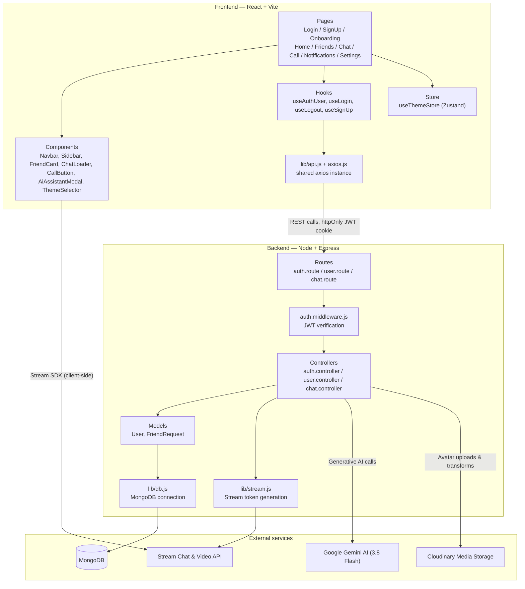
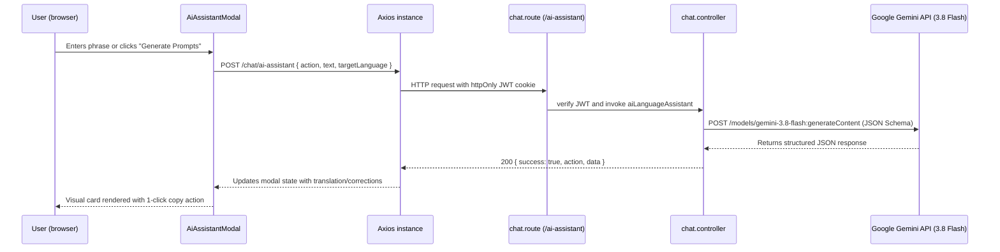
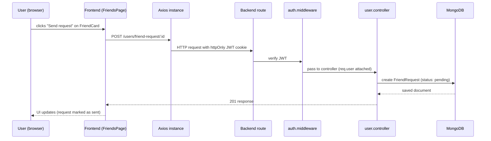

# Architecture

## High-level architecture



The frontend never talks to Stream's API directly for auth — it calls the backend for a Stream token (`lib/stream.js`), then uses that token to connect the Stream Chat/Video client in the browser. Similarly, all AI language requests are proxied securely through the backend (`POST /api/chat/ai-assistant`) using server-side Gemini credentials, and profile avatars are handled via Cloudinary (`lib/cloudinary.js`).

## Technology stack

**Frontend**: React, Vite, React Router, TanStack Query, Zustand (`useThemeStore`), Axios, Tailwind CSS, DaisyUI, Stream Chat & Stream Video SDKs, Vitest for unit & integration testing.

**Backend**: Node.js, Express, MongoDB with Mongoose, JWT (httpOnly cookies) for auth, Helmet for HTTP security headers, express-rate-limit for abuse mitigation, Cloudinary SDK for profile media optimization, Stream Chat & Stream Video server SDK for token generation, Google Gemini API (Gemini 3.8 Flash) for conversational language assistance.

**Hosting & DevOps**: Render Blueprint (`render.yaml`), Node test runner (`node:test`), with a keep-alive cron job to avoid cold starts.

## Security architecture

- **Password Protection**: Passwords are hashed with bcrypt (salt rounds = 10) and configured with `select: false` in the Mongoose schema. In addition, Mongoose `toJSON` and `toObject` transforms ensure password hashes are never serialized or leaked across API responses.
- **HTTP Security Headers**: Powered by `helmet` to mitigate clickjacking, MIME-sniffing, and cross-site scripting risks.
- **Rate Limiting**: Tiered rate limiters via `express-rate-limit` guard `/api/auth/login` and `/api/auth/signup` against credential stuffing and brute-force attacks, alongside an umbrella API rate limiter.
- **Mass Assignment Prevention**: Strict field whitelisting in profile update and onboarding controllers prevents arbitrary field manipulation (e.g. unauthorized friend array tampering or internal flags).
- **CORS Protection**: Dynamic origin checking matching trusted development ports (`http://localhost:5173`, `http://localhost:3000`) and production `CLIENT_URL`.
- **JWT Expiration Handling**: Returns standardized `401 Unauthorized` responses on token expiration or signature mismatch, enabling clean client-side re-authentication.

## Social architecture & connection lifecycle

Streamify manages the complete two-way social lifecycle:
- **Connection States**: Supported statuses in `FriendRequest` are `pending`, `accepted`, and `rejected`.
- **Request Cancellation**: Outgoing pending requests can be recalled/cancelled by the sender before acceptance.
- **Request Decline**: Recipients can accept or decline (`rejected`) incoming connection requests.
- **Mutual Unfriend**: Removing a friend executes atomic `$pull` operations on both users' `friends` collections and clears request documents.
- **Notification Dismissal**: Senders can dismiss accepted connection notices to keep their notifications view clean.
- **Responsive Navigation**: Adaptive view layout presenting a sticky sidebar on large screens (`lg+`) and an accessible mobile bottom navigation bar (`< lg`) alongside an adaptive top navbar with brand branding.

## Video calling & real-time communication architecture

- **Channel & Call Authorization**: Gated by server-side verification (`/api/chat/verify/:targetUserId` and `/api/chat/verify-call/:callId`). Unauthorized users attempting to navigate to private chats or call rooms are blocked.
- **Immediate Caller Routing**: Initiating a video call automatically publishes a call invite to the chat channel and smoothly navigates the caller directly into the Stream Video call room.
- **Real-Time Incoming Call Prompts**: The chat channel registers a real-time `message.new` listener that intercepts incoming call invitations and displays an interactive floating banner with direct **Join Call** and **Dismiss** controls.
- **1-Click Call Access**: Direct video calling shortcuts on `FriendCard` allow starting a session directly from the user's friend directory.
- **Resource Lifecycle Management**: Stream Video and Stream Chat clients implement strict cleanup on unmount, gracefully releasing cameras, microphones, and WebSocket instances.

## Smart reciprocal matching engine

The recommendation system evaluates reciprocal language synergy between the authenticated user and potential partners:
- **Scoring Tiers**:
  - **Perfect Exchange (100% Match)**: The candidate is a native speaker of the language the user is learning, and the candidate is learning the language the user speaks natively (`userNative === candLearning && userLearning === candNative`).
  - **Native Speaker (75% Match)**: The candidate is a native speaker of the user's target learning language (`candNative === userLearning`).
  - **Study Partner (50% Match)**: Both users are actively learning the same target language (`candLearning === userLearning`).
  - **Practice Partner (40% Match)**: The candidate is learning the user's native tongue (`candLearning === userNative`).
  - **Community Member (15% Match)**: Registered, onboarded learner in the global community.
- **Dynamic Query Filtering**:
  - `search`: Case-insensitive regex matching across name, biography, or city.
  - `language`: Precise filtering on either native or target languages.
  - `matchType`: Category filtering (`perfect`, `native`, `study`).
- **Ranking**: Matches are sorted descending by compatibility score so top partners appear first.

## Gemini AI language assistant architecture

- **Model & Transport**: Powered by Google's `gemini-3.8-flash` model using server-side REST requests over HTTPS with strict JSON schema enforcement (`responseMimeType: "application/json"`).
- **Security & Privacy**: The client never sees or handles raw Gemini API credentials; requests pass through authenticated backend proxy (`POST /api/chat/ai-assistant`).
- **Core AI Tools**:
  1. **Instant Translation**: Nuanced conversational translation with phonetic guides, cultural context, and colloquial alternatives.
  2. **Grammar Inspection**: Identifies grammatical errors, explains linguistic rules, and suggests natural, fluent variations.
  3. **Contextual Icebreakers**: Generates tailored, culturally authentic conversation starter prompts and vocabulary tips for the specific language pair.
- **Client Integration**: Rendered via `AiAssistantModal.jsx` within the active chat window, featuring one-click copy-to-clipboard actions and partner language auto-detection.

## Cloud media storage & avatar pipeline

- **Cloudinary Integration**: Configured in `lib/cloudinary.js` using `CLOUDINARY_CLOUD_NAME`, `CLOUDINARY_API_KEY`, and `CLOUDINARY_API_SECRET`.
- **Upload Transformations**: Base64 device uploads are automatically resized and cropped around detected facial features (`width: 256, height: 256, crop: "fill", gravity: "face"`) with automated WebP format negotiation (`quality: "auto", fetch_format: "auto"`).
- **Client-Side Validation**: Both onboarding and settings pages enforce image type validation (`image/*`) and strict 5MB file size boundaries before FileReader encoding.
- **Resilient Fallback**: If Cloudinary credentials are omitted or temporarily unavailable, avatars safely persist or default to generated Dicebear/Liara SVG avatars without service disruption.

## Database compound indexes & query optimization

- **`FriendRequest` Collection**:
  - `{ sender: 1, recipient: 1 }`: Accelerated lookup for connection existence checks.
  - `{ recipient: 1, status: 1 }`: Speeds up incoming friend requests queries.
  - `{ sender: 1, status: 1 }`: Optimizes outgoing pending requests queries.
  - `{ recipient: 1, status: 1, dismissed: 1 }`: Fast index scan for notification badge lists.
- **`User` Collection**:
  - `{ nativeLanguage: 1, learningLanguage: 1, isOnboarded: 1 }`: Optimized index for reciprocal language partner discovery.
  - `{ isOnboarded: 1, _id: 1 }`: Rapid exclusion scans for recommended user suggestions.
  - `{ fullName: "text", bio: "text", location: "text" }`: Full-text search support.

## Automated test suite & deployment architecture

- **Frontend Testing**: Vitest test suites (`Frontend/src/test/`) covering reciprocal matching scoring tiers and UI utility transformations.
- **Backend Testing**: Node.js test runner (`node:test`) covering Cloudinary helpers, call authorization parsers, and AI payload validators.
- **Root Test Command**: `npm test` runs all backend and frontend suites concurrently with exit code validation.
- **Production Blueprint**: `render.yaml` infrastructure-as-code manifest declaring build, runtime, and environment variables for deployment on Render.

## Folder structure

```
Streamify/
├── Backend/
│   ├── src/
│   │   ├── controllers/
│   │   │   ├── auth.controller.js # Profile updates & Cloudinary media integration
│   │   │   ├── chat.controller.js # Stream token, verification & Gemini AI assistant
│   │   │   └── user.controller.js # Reciprocal matching, profiles & connections
│   │   ├── lib/
│   │   │   ├── cloudinary.js      # Cloudinary SDK initialization & checks
│   │   │   ├── db.js              # MongoDB connection
│   │   │   └── stream.js          # Stream token generation
│   │   ├── middleware/
│   │   │   └── auth.middleware.js # JWT verification, protects routes
│   │   ├── models/
│   │   │   ├── FriendRequest.js   # Compound indexed connection model
│   │   │   └── User.js            # Compound indexed learner model
│   │   ├── routes/
│   │   │   ├── auth.route.js
│   │   │   ├── chat.route.js
│   │   │   └── user.route.js
│   │   └── server.js              # entry point
│   ├── test/
│   │   └── unit.test.js           # Backend node:test test suite
│   ├── package.json
│   └── .env
│
├── Frontend/
│   ├── src/
│   │   ├── components/
│   │   │   ├── AiAssistantModal.jsx # Gemini AI tools drawer/modal
│   │   │   ├── CallButton.jsx
│   │   │   ├── ChatLoader.jsx
│   │   │   ├── FriendCard.jsx
│   │   │   ├── Layout.jsx
│   │   │   ├── MobileBottomNav.jsx
│   │   │   ├── Navbar.jsx
│   │   │   ├── NoFriendsFound.jsx
│   │   │   ├── NoNotificationsFound.jsx
│   │   │   ├── PageLoader.jsx
│   │   │   ├── Sidebar.jsx
│   │   │   └── ThemeSelector.jsx
│   │   ├── constants/
│   │   ├── hooks/
│   │   ├── lib/
│   │   ├── pages/
│   │   ├── store/
│   │   ├── test/
│   │   │   ├── matching.test.js   # Reciprocal matching Vitest suite
│   │   │   └── utils.test.js      # Utility Vitest suite
│   │   ├── App.jsx
│   │   └── main.jsx
│   ├── package.json
│   └── .env
│
├── Project Details/
├── render.yaml                    # Production deployment blueprint
├── package.json
└── README.md
```

## Request flow example: Gemini AI language assistance



## Request flow example: sending a friend request

