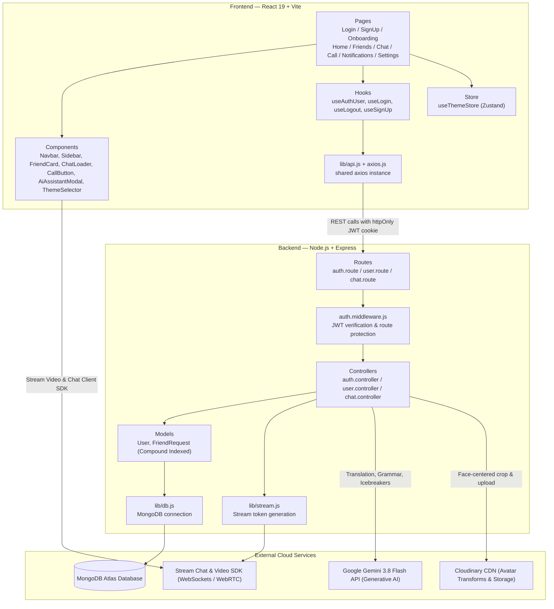

# Streamify

A modern language exchange platform connecting language learners worldwide through smart reciprocal matching, real-time messaging, video calling, and Gemini AI language tools.

[](https://streamify-2-ezk2.onrender.com)
[](https://react.dev/)
[](https://nodejs.org/)
[](https://www.mongodb.com/)
[](https://ai.google.dev/)
[](https://getstream.io/)
[](https://tailwindcss.com/)

---

## System Architecture



---

## Description

Streamify is a full-stack web application designed to help language learners connect with native speakers and fellow learners. The platform features user authentication, friend matching based on language preferences, real-time messaging, and video calling capabilities. Users can create profiles with their native and target languages, discover compatible language partners, and engage in meaningful conversations to improve their language skills.

## Features

- **User Authentication**: Secure signup/login with JWT tokens stored in httpOnly cookies, password hashing with bcrypt, and brute-force protection
- **User Onboarding**: Complete profile setup with language preferences, bio, location, and device photo uploads
- **Cloud Media Storage**: Cloudinary integration for profile avatars featuring automated face-centering crop, auto-format optimization, and 5MB client-side validation
- **Smart Reciprocal Matching**: Discover language partners ranked by mutual compatibility (100% Perfect Exchange, 75% Native Speaker, 50% Study Partner), with real-time keyword search and language filters
- **Gemini AI Language Tools**: Integrated in-chat AI assistant powered by Google's Gemini 3.8 Flash for instant translation with phonetics, grammar error checking with explanations, and contextual conversation icebreakers
- **Friend System**: Send, accept, decline, or cancel friend requests, unfriend partners, and dismiss notices
- **Real-time Chat**: Instant messaging powered by Stream Chat with participant authorization
- **Video Calling**: High-quality video calls using Stream Video SDK with 1-click friend call access and in-chat call notification prompts
- **Responsive Design**: Mobile-friendly interface with mobile bottom navigation, DaisyUI, and Tailwind CSS
- **Automated Testing**: Vitest and Node test runner covering matching algorithms, security verification, and media utilities
- **Theme Support**: Multiple UI themes for personalized experience

## Tech Stack

### Frontend
- **React 19** - Modern UI library
- **Vite** - Fast build tool and dev server
- **Vitest** - Unit and integration testing
- **React Router** - Client-side routing
- **Tailwind CSS** - Utility-first CSS framework
- **DaisyUI** - Component library for Tailwind
- **Stream Chat React** - Real-time messaging components
- **Stream Video React SDK** - Video calling functionality
- **Zustand** - State management
- **React Query** - Server state management
- **Axios** - HTTP client

### Backend
- **Node.js** - JavaScript runtime
- **Express.js** - Web application framework
- **MongoDB** - NoSQL database
- **Mongoose** - MongoDB object modeling
- **Cloudinary** - Media asset cloud storage & transformations
- **Google Gemini API** - Conversational AI language assistant (`gemini-3.8-flash`)
- **Stream Chat** - Chat backend service
- **JWT** - Authentication tokens
- **bcryptjs** - Password hashing
- **CORS** - Cross-origin resource sharing

## Installation

### Prerequisites
- Node.js (v16 or higher)
- MongoDB database
- Stream.io account (for chat and video features)

### 1. Clone the repository
```bash
git clone https://github.com/kushGupta-15/Streamify.git
cd Streamify
```

### 2. Install dependencies
```bash
# Install root dependencies
npm install

# Install backend dependencies
cd Backend
npm install

# Install frontend dependencies
cd ../Frontend
npm install
```

### 3. Environment Setup

#### Backend Environment (.env in Backend folder)
```env
PORT=5001
MONGO_URI=your_mongodb_connection_string
STEAM_API_KEY=your_stream_api_key
STEAM_API_SECRET=your_stream_api_secret
JWT_SECRET_KEY=your_jwt_secret_key
NODE_ENV=development
GEMINI_API_KEY=your_gemini_api_key
CLOUDINARY_CLOUD_NAME=your_cloudinary_cloud_name # optional for cloud media uploads
CLOUDINARY_API_KEY=your_cloudinary_api_key       # optional
CLOUDINARY_API_SECRET=your_cloudinary_api_secret # optional
```

#### Frontend Environment (.env in Frontend folder)
```env
VITE_STREAM_API_KEY=your_stream_api_key
```

### 4. Database Setup
Ensure your MongoDB database is running and accessible via the connection string in your backend .env file.

## Usage

### Development Mode

1. **Start the backend server:**
```bash
cd Backend
npm run dev
```
The backend will run on `http://localhost:5001`

2. **Start the frontend development server:**
```bash
cd Frontend
npm run dev
```
The frontend will run on `http://localhost:5173`

### Running Automated Tests
Run both backend and frontend test suites from the root repository:
```bash
npm test
```
Or run individually:
- Backend: `npm test --prefix Backend` (Node.js test runner)
- Frontend: `npm test --prefix Frontend` (Vitest)

### Production Mode

1. **Build the application:**
```bash
npm run build
```

2. **Start the production server:**
```bash
npm start
```

### Using the Application

1. **Sign Up**: Create a new account with email and password
2. **Onboarding**: Complete your profile with:
   - Full name and bio
   - Native language
   - Language you want to learn
   - Location
3. **Discover**: Browse recommended language partners
4. **Connect**: Send friend requests to potential language partners
5. **Chat**: Start conversations with your friends
6. **Video Call**: Initiate video calls directly from chat

## API Endpoints

### Authentication
- `POST /api/auth/signup` - User registration
- `POST /api/auth/login` - User login
- `POST /api/auth/logout` - User logout
- `POST /api/auth/onboarding` - Complete user onboarding
- `PUT /api/auth/profile` - Update user profile
- `GET /api/auth/me` - Get currently logged-in user (session check)

### Users
*All routes below require authentication.*
- `GET /api/users?search=&language=&matchType=` - Get recommended partners ranked by reciprocal compatibility
- `GET /api/users/friends` - Get user's friends list
- `DELETE /api/users/friends/:id` - Unfriend a connected user
- `POST /api/users/friend-request/:id` - Send a friend request to user `:id`
- `PUT /api/users/friend-request/:id/accept` - Accept a friend request
- `PUT /api/users/friend-request/:id/reject` - Decline a friend request
- `DELETE /api/users/friend-request/:id` - Cancel a pending friend request
- `GET /api/users/friend-requests` - Get incoming (pending) and accepted friend requests
- `PUT /api/users/friend-requests/:id/dismiss` - Dismiss an accepted connection notification
- `GET /api/users/outgoing-friend-requests` - Get friend requests sent by current user (pending)

### Chat, Video & AI Language Tools
- `GET /api/chat/token` - Get Stream chat token
- `GET /api/chat/verify/:targetUserId` - Verify friendship access before joining private chat
- `GET /api/chat/verify-call/:callId` - Verify participant authorization before joining video call
- `POST /api/chat/ai-assistant` - Gemini AI language assistance (`translate`, `grammar-check`, `icebreakers`)

## Project Structure

```
Streamify/
├── Backend/
│   ├── src/
│   │   ├── controllers/     # Route handlers
│   │   ├── middleware/      # Custom middleware
│   │   ├── models/          # Database models
│   │   ├── routes/          # API routes
│   │   ├── lib/             # Utility functions
│   │   └── server.js        # Express server setup
│   ├── package.json
│   └── .env
├── Frontend/
│   ├── src/
│   │   ├── components/      # Reusable UI components
│   │   ├── pages/           # Page components
│   │   ├── hooks/           # Custom React hooks
│   │   ├── lib/             # Utility functions
│   │   ├── store/           # State management
│   │   └── constants/       # App constants
│   ├── package.json
│   └── .env
├── package.json             # Root package.json
└── README.md
```